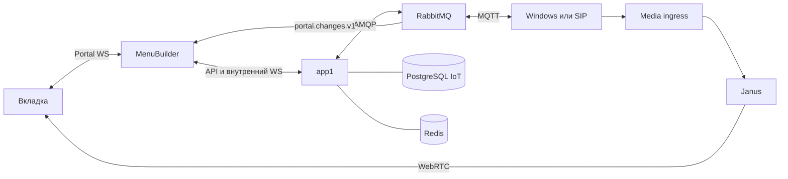

# IoT Platform · эксплуатационная архитектура

При разборе инцидента сначала установите, что именно подтвердил терминал: подключение к брокеру, выполнение команды или готовность потока. У каждого этапа свой владелец. Эта карта описывает маршрут запроса и точки наблюдения для дежурного.

## Путь команды и состояния

Консоль сохраняет отдельный diagnostics WS с допуском через MenuBuilder. У Janus собственный сигнальный WS. Публичная вкладка не получает доступ к AMQP или внутренним сервисным ключам.

| Домен | Ответственность app1 | Что проверять |
|---|---|---|
| Устройство | Принять MQTT presence и результат RPC, связать с SN и организацией. | TLS и ACL устройства, потребитель нужной очереди, корреляция запроса и ответа. |
| Desktop и камера | Согласовать аренду, состояние потока и команды качества. После принятого отчёта ограничить частоту публикации снимка и подписать его с учётом организации, устройства и потока. | Различать START, подтверждение источника и получение кадра. Для управления проверять scope, владельца и ACK. |
| Доставка в портал | Передать ограниченный набор полей качества и уведомления через существующий exchange. Потеря уведомления допускает восстановление из актуального состояния. | Проверить producer, consumer MenuBuilder, состояние device watch, срок снимка и fallback GET. Полный native report остаётся у владельца. |
| Файлы, консоль, события | Доставка и корреляция в границах действующей сессии. Для консоли роли 1 и 5, явная аренда и отдельная проверка сервисного допуска. | При таймауте сначала выяснить, принял ли команду агент. Повтор ввода или файловой операции может иметь побочный эффект. |

## Конфигурация и поставка

- **Настройки процесса.** В [модели конфигурации](../app-service/core/config.py) вложенные разделы загружаются через `APP_CONFIG__` и разделитель `__`. DB и FastStream требуют корректного DSN; Redis, таймауты и пул соединений проверяют в соответствующем разделе. Конфигурация может переписать адрес на имя Compose-сервиса.
- **Идентичность.** RabbitMQ проверяет сертификат и применяет ACL; права внутреннего HTTP-клиента и идентичность оператора проверяются отдельно. Список публичных полей снимка и привязка HMAC находятся в [producer](../app-service/core/portal_changes.py).
- **Релиз.** Интеграционная ветка — master. На builder скрипт registry_app1.py проверяет принятый SHA и публикует образ. В production подтягивается digest, проверяются revision label, конфигурация, сети, здоровье и работоспособность RPC. При откате используют предыдущий проверенный digest.

[Релиз app1](manual-app1-deploy-runbook.md) · [RabbitMQ и ACL](rabbitmq-acl-recovery.md) · [Redis](redis/redis-integration-guide.md) · [Общий DevOps-runbook](https://github.com/OlegLebedevRU/etranprocessing/blob/main/docs/ops_run-production-stack.md)
